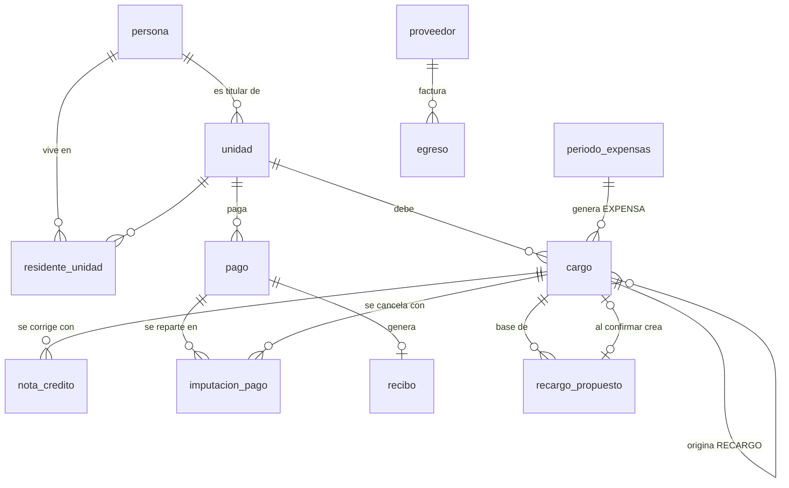
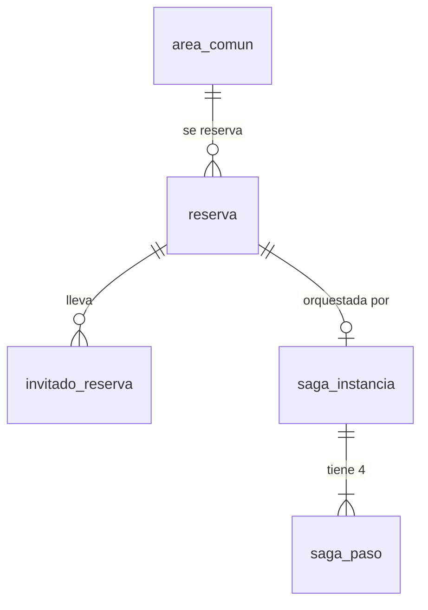

# Modelo de datos — CondoHub

Persistencia políglota: cada contexto delimitado (DDD) tiene **su propia base**, elegida por la forma de sus datos. Ningún servicio lee la base de otro; los datos ajenos llegan por API o por evento. Entre bases solo se referencia **por id** (sin claves foráneas).

| Contexto / servicio | Motor | Base | Por qué este motor | Archivos |
|---|---|---|---|---|
| Finanzas (Gestión) | PostgreSQL 16 | `gestion` | Contabilidad: necesita ACID, integridad referencial y consultas agregadas | `services/gestion/src/main/resources/db/migration/V1__esquema_finanzas.sql`, `V2__vistas_finanzas.sql`, `db/seed/R__datos_demo.sql` |
| Reservas | PostgreSQL 16 | `reservas` | Rangos de tiempo sin solape garantizados por la base (`EXCLUDE`) y estado de la saga transaccional | `services/reservas/database/sql/001_esquema_reservas.sql` (+ migración Laravel que lo ejecuta) |
| Acceso | DynamoDB | tabla `condohub-acceso` | Muchas escrituras pequeñas, append-only, clave-valor, escritura condicional para idempotencia | `services/acceso/db/tabla-acceso.json`, `crear-tabla.mjs`, `datos-demo.mjs` |
| IA | MongoDB 7 | `ia` | Resultados de forma variable, embeddings de 512 dimensiones, TTL nativo | `services/ia/db/mongo-init.js` |
| Agentes | MongoDB 7 | `agentes` | Misiones y bitácora como documentos anidados; memoria del agente | `services/agentes/db/mongo-init.js` |
| Archivos | MinIO (S3) | buckets | Fotos, audio, comprobantes, pesos de modelos: nunca en las bases ni en git (I6) | — |

Arranque: `docker compose -f infra/docker-compose.yml up -d` crea las bases y usuarios de PostgreSQL (`infra/postgres/init/01-bases.sql`), las colecciones de MongoDB y la tabla de DynamoDB. Las tablas de PostgreSQL las crea cada servicio con sus migraciones.

## 1. Gestión (PostgreSQL `gestion`)

Tablas de soporte: `parametro` (valores de negocio), `outbox`, `evento_procesado`. Vistas de lectura: `v_estado_cuenta`, `v_morosos`, `v_cargo_vencido`, `v_morosidad_por_bloque`, `v_suma_alicuotas`.

Agregados (ver `docs/arquitectura/ddd.md`): `Unidad` = unidad + residente_unidad · `CuentaUnidad` = cargo + nota_credito + imputacion_pago · `PeriodoExpensas` = periodo_expensas · `Pago` = pago + recibo.

| Regla | Cómo la protege la base |
|---|---|
| F1 | `unidad.propietario_titular_id NOT NULL`; residentes con vigencia en `residente_unidad` |
| F2 | Vista `v_suma_alicuotas` (el dominio no emite si `cuadra = false`); `alicuota > 0` |
| F3 | Índice único `ux_cargo_expensa_periodo`: una expensa por unidad y periodo |
| F4 | `fecha_vencimiento` en cada cargo; vistas `v_cargo_vencido` y `v_morosos` |
| F5 | `recargo_propuesto` separado de `cargo`; trigger exige ADMIN y cargo tipo RECARGO al confirmar |
| F6 | Trigger `tg_cargo_inmutable`: no se borra ni se edita monto/tipo/unidad/fechas; correcciones en `nota_credito` |
| F7 | `imputacion_pago` solo con pagos CONFIRMADOS (trigger); índice FIFO `ix_cargo_pendiente_fifo`; saldo a favor en `v_estado_cuenta` |
| F8 | Rechazo exige motivo (CHECK); `recibo` solo de pagos confirmados (trigger), numeración correlativa |
| F9 | `pago.estado` nace `PENDIENTE` |
| F10 | `NUMERIC(12,2)` y `CHECK (monto > 0)` en todo importe |
| O3 | `pago.idempotency_key UNIQUE` |
| S4/S5 | `outbox` y `evento_procesado`; `ux_cargo_referencia` evita cargos duplicados de una saga |

## 2. Reservas (PostgreSQL `reservas`)

`reserva.unidad_id` referencia por id a una unidad de Finanzas (otra base).

| Regla | Cómo la protege la base |
|---|---|
| R1 | Áreas cargadas en la migración (salón 80, piscina 20, churrasqueras 15) |
| R2 | `EXCLUDE USING gist (area_id WITH =, horario WITH &&)` solo para reservas SOLICITADA/CONFIRMADA: imposible solapar aun con dos pedidos simultáneos; horario y bloque mínimo en `area_comun` |
| R3 | Parámetros en `parametro`; índice `ix_reserva_unidad_activa` para contar activas |
| R5 | CHECK: solo el salón tiene garantía; costo y garantía se copian a la reserva |
| R6 | `con_danios` solo cuando la reserva está FINALIZADA |
| R8 | Trigger `tg_reserva_transicion`: solo transiciones válidas; FALLIDA/CANCELADA exigen motivo |
| O1/O5 | `idempotency_key UNIQUE`, `version` para bloqueo optimista |
| S1–S3 | `saga_instancia` (estado, paso actual, próximo reintento) + `saga_paso` (intentos, compensaciones) |
| S4/S5 | `outbox`, `evento_procesado` |

## 3. Acceso (DynamoDB, tabla única `condohub-acceso`)

| Entidad | PK | SK | GSI1 (PK / SK) | GSI2 (PK / SK) | Otros |
|---|---|---|---|---|---|
| Visita | `UNIDAD#<codigo>` | `VISITA#<fecha>#<id>` | | | |
| Pase | `PASE#<codigo>` | `META` | `PASES#<fecha>` / `PASE#<codigo>` | | `estado`, `usos`, `usosMaximos`, ventana |
| Registro de acceso | `DIA#<fecha>` | `ACCESO#<ts>#<id>` | | `UNIDAD#<codigo>` / `ACCESO#<ts>` | `horaDispositivo`, `horaServidor`, `idempotencyKey` |
| Vehículo de residente | `PLACA#<placa>` | `META` | `UNIDAD#<codigo>` / `PLACA#<placa>` | | |
| Idempotencia | `IDEM#<uuid>` | `META` | | | respuesta original, `expiraEn` (TTL 7 días) |
| Evento procesado | `EVT#<eventId>` | `META` | | | `expiraEn`; en un comando de la saga, también su respuesta (`mensaje`, `routingKey`) |
| Pases de una reserva | `RESERVA#<reservaId>` | `META` | | | `estado` (`EMITIDA`/`REVOCADA`), `pases` (invitado → código) |
| Cursor del relevo | `RELEVO#<fragmento>` | `META` | | | `secuencia`: último registro del stream ya publicado |
| Alerta | `ALERTAS#<fecha>` | `ALERTA#<ts>#<id>` | | | tipo, clusterId |

Patrones de acceso: pases vigentes del día para la PWA (GSI1 `PASES#<fecha>`), validar un QR (`PASE#<codigo>`), bitácora del día (`DIA#<fecha>`), historial de una unidad (GSI2), reconocer una placa (`PLACA#<placa>`).

| Regla | Cómo la protege la base |
|---|---|
| O3 | `TransactWriteItems`: `IDEM#<uuid>` con `attribute_not_exists(PK)` + el registro; si falla la condición, se devuelve la respuesta guardada |
| A1/A2 | Usar un pase = `UpdateItem` con condición `usos < usosMaximos AND estado = VIGENTE` |
| A3 | Los registros solo se insertan (`attribute_not_exists`); la app no tiene operación de edición |
| S4 | DynamoDB Streams (`NEW_IMAGE`) publica `AccesoRegistrado` y `PaseEmitido` (equivale al outbox): la respuesta de la saga se guarda en el mismo ítem `EVT#` que marca el comando atendido y el relevo la publica desde el stream |

## 4. IA (MongoDB `ia`)

| Colección | Contenido | Reglas |
|---|---|---|
| `perfiles_faciales` | residente, unidad, consentimiento, embeddings de 512 dimensiones con modelo y versión | I1 (validador: sin consentimiento vigente no hay embeddings), I2 |
| `desconocidos` | embedding, cámara, día, cluster | I3 (índice TTL de 30 días con `expiraEn`) |
| `clusters_desconocidos` | resultado de cada corrida de DBSCAN, apariciones, días distintos, alertado | I4 |
| `predicciones` | toda inferencia de rostro o placa con confianza, umbral, modelo, versión y latencia | I5 |
| `modelos` | registro de modelos entrenados con métricas; un solo activo por tarea (índice único parcial). Tareas: reconocimiento facial, detección y OCR de placas, lectura de placas con CNN (`LECTURA_PLACAS_CNN`, formatos `KERAS`/`TFLITE`, además de `PYTORCH`, `ONNX`, `ONNX_INT8`, `SKLEARN`), clustering | I5, informe de ML |
| `reportes` | `reporteId`, transcripción, consulta GraphQL (validador: solo `query`; una consulta rechazada por G4 no se guarda, queda el motivo), archivo generado (clave en S3), estado `PROCESANDO/LISTO/FALLIDO` | G4 |

## 5. Agentes (MongoDB `agentes`)

| Colección | Contenido | Reglas |
|---|---|---|
| `misiones` | objetivo, estado, pasos ejecutados, límite de pasos | G1 |
| `confirmaciones` | herramienta, argumentos, riesgo; el validador exige ADMIN y fecha para aprobar | G2, F5 |
| `bitacora` | cada paso: herramienta, entrada, salida, quién confirmó | G3 |
| `memoria` | lo que el agente recuerda por unidad o global, con expiración opcional | G1 |
| `metricas` | una lectura del monitoreo: unidades morosas, deuda vencida (`Decimal128`), pagos pendientes, días del más antiguo; solo se agregan | G5 |
| `informes` | cada ejecución del agente de monitoreo: métricas, alertas (tipo, severidad), resumen, si se avisó a n8n; `informeId` único | G5 |

## 6. Datos de demostración

- Gestión: 200 unidades (bloque A: 50 casas al 0,65 %; bloques B, C y D: 150 departamentos al 0,45 %; suman 100 %), expensas de agosto a octubre de 2026 con un presupuesto de 60 000, 40 unidades de los bloques B y C con deudas (20 bloqueadas para reservar por R4), 2 pagos pendientes de conciliar y proveedores con egresos. Se cargan solo en el perfil `dev` (`spring.flyway.locations=classpath:db/migration,classpath:db/seed`).
- Acceso: 50 placas de residentes, una visita con pase QR del día y un ingreso.
- Usuarios demo con el `sub` fijo de Keycloak: admin `…a001`, residente `…a002` (titular de A-101), guardia `…a003`. El realm de Keycloak crea esos usuarios con esos ids (`infra/keycloak/realm-condohub.json`, verificado).

## 7. Reglas para cambiar el esquema

- Nunca se edita una migración ya mergeada: se agrega una nueva (`V3__...`, `002_...`). Es la regla de oro del `CLAUDE.md` aplicada a la base.
- Un cambio de esquema que afecte a un contrato (GraphQL, evento) va primero en `contracts/`.
- Las pruebas de la base (`pruebas_reglas_bd.sql` en Gestión y Reservas) deben seguir pasando.
